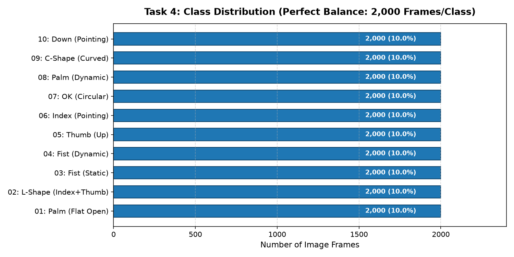
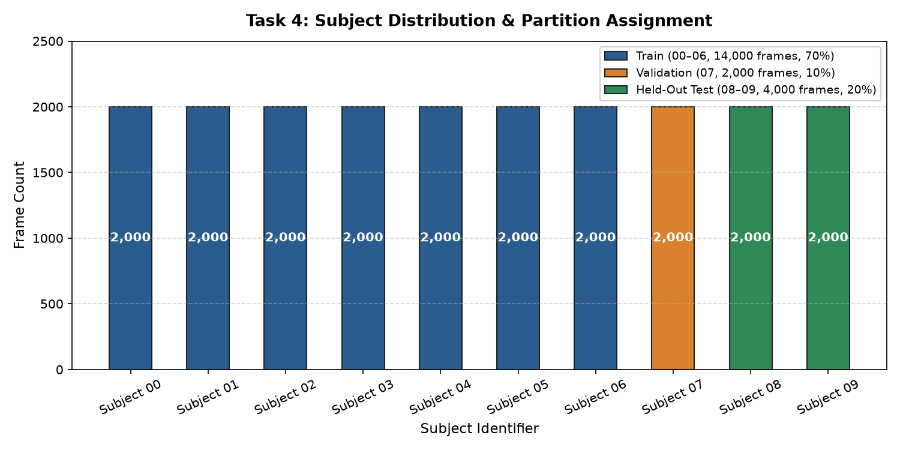
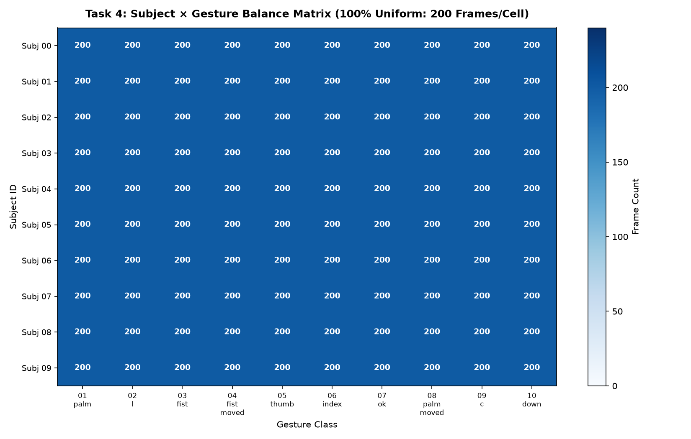
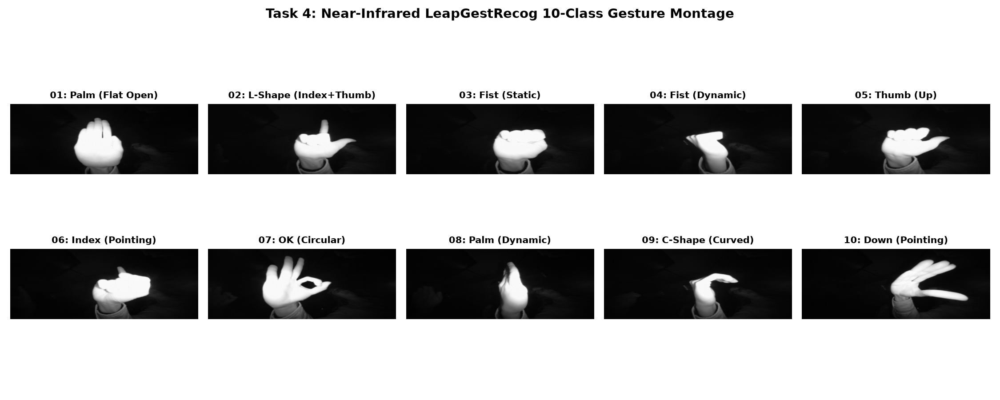
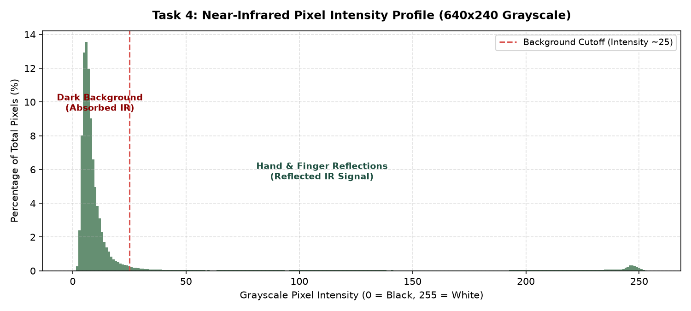

# Task 4 — Exploratory Data Analysis (EDA) Summary Report
**Project:** Hand Gesture Recognition (LeapGestRecog GTI-UPM Dataset)  
**Dataset Modality:** Near-Infrared (NIR) 8-Bit Grayscale Sensor Frames  
**Total Canonical Frames:** 20,000 unique images  

---

## 1. Executive Summary & Key Findings

1. **Perfect Dataset Balance:**
   - The canonical dataset contains exactly **20,000 frames** evenly distributed across **10 subjects** and **10 gesture classes**.
   - Exactly **2,000 frames per class** (10.0% each) and **200 frames per subject-gesture pair** ($10 \times 10 = 100$ cells).
   - Zero class imbalance exists; baseline guessing accuracy is exactly **10.0%**.

2. **Subject-Independent Split Isolation:**
   - To prevent catastrophic temporal and identity data leakage between consecutive frames ($t$ and $t+1$), splitting is performed strictly **by subject ID**:
     - **Train:** Subjects `00, 01, 02, 03, 04, 05, 06` (14,000 frames, 70.0%)
     - **Validation:** Subject `07` (2,000 frames, 10.0%)
     - **Held-Out Test:** Subjects `08, 09` (4,000 frames, 20.0%)
   - Split subject sets are **100% pairwise disjoint** (zero subject overlap).

3. **Near-Infrared Sensor Characteristics:**
   - Image format: **PNG**, Single-channel Grayscale (`L` mode), native resolution **640 $\times$ 240** pixels (aspect ratio **2.67:1**).
   - **Bimodal Intensity Distribution:** The infrared background is dark (mean background intensity < 25), while human hands and fingers strongly reflect NIR illumination (intensities up to 255).
   - **Foreground Proportion:** Across analyzed frames, approximately **11.53%** of pixels represent the active hand foreground.

---

## 2. Gesture Class Distribution

| Class Identifier | Gesture Description | Sample Count | Proportion |
| :--- | :--- | :--- | :--- |
| `01_palm` | 01: Palm (Flat Open) | 2,000 | 10.0% |
| `02_l` | 02: L-Shape (Index+Thumb) | 2,000 | 10.0% |
| `03_fist` | 03: Fist (Static) | 2,000 | 10.0% |
| `04_fist_moved` | 04: Fist (Dynamic) | 2,000 | 10.0% |
| `05_thumb` | 05: Thumb (Up) | 2,000 | 10.0% |
| `06_index` | 06: Index (Pointing) | 2,000 | 10.0% |
| `07_ok` | 07: OK (Circular) | 2,000 | 10.0% |
| `08_palm_moved` | 08: Palm (Dynamic) | 2,000 | 10.0% |
| `09_c` | 09: C-Shape (Curved) | 2,000 | 10.0% |
| `10_down` | 10: Down (Pointing) | 2,000 | 10.0% |

---

## 3. Subject Distribution & Partition Strategy

| Split Partition | Assigned Subjects | Total Images | Dataset Proportion |
| :--- | :--- | :--- | :--- |
| **TRAIN** | `00, 01, 02, 03, 04, 05, 06` | 14,000 | 70.0% |
| **VAL** | `07` | 2,000 | 10.0% |
| **TEST** | `08, 09` | 4,000 | 20.0% |

---

## 4. Subject × Gesture Balance Matrix

The 10 subjects and 10 gestures form a completely uniform $10 \times 10$ orthogonal grid with exactly **200 frames per cell**:

---

## 5. Visual Gesture Montage

A representative sample of all 10 hand gesture classes captured by the near-infrared camera:

---

## 6. Sensor Pixel Intensity Profile

Near-infrared sensor frames demonstrate high foreground/background contrast:
- **Global Mean Intensity:** 25.31 $\pm$ 51.15 (on a 0–255 scale)
- **Minimum Intensity:** 0 | **Maximum Intensity:** 255
- **Native Dimensions:** 640 (W) $\times$ 240 (H) pixels

---

## 7. Actionable Recommendations for Phase 4 Modeling

1. **Aspect Ratio Preservation:**
   - Raw frames have a wide 2.67:1 aspect ratio ($640 \times 240$). When resizing for feature extraction (e.g. HOG, PCA, or lightweight CNN), resizing to $160 \times 60$ or $128 \times 64$ preserves hand contours without severe non-isometric distortion.
2. **Feature Extraction Viability:**
   - The stark NIR contrast makes **Histogram of Oriented Gradients (HOG)** exceptionally well-suited: hand contours, finger orientations (e.g., thumb vs index vs fist), and wrist shapes have clean gradient directions.
3. **Generalization Benchmark:**
   - Evaluated models must generalize to unseen subjects (`08` and `09`) who have different hand sizes, skin tones, and positioning. Cross-entropy loss or linear SVM margin on subject `07` (validation) will accurately guide hyperparameter tuning without test set contamination.
