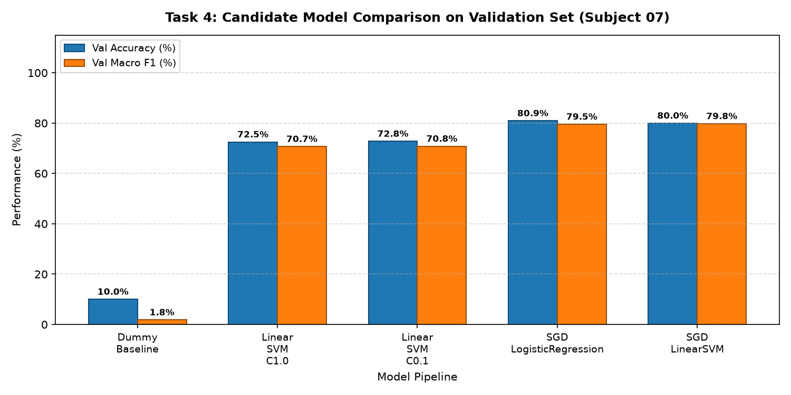
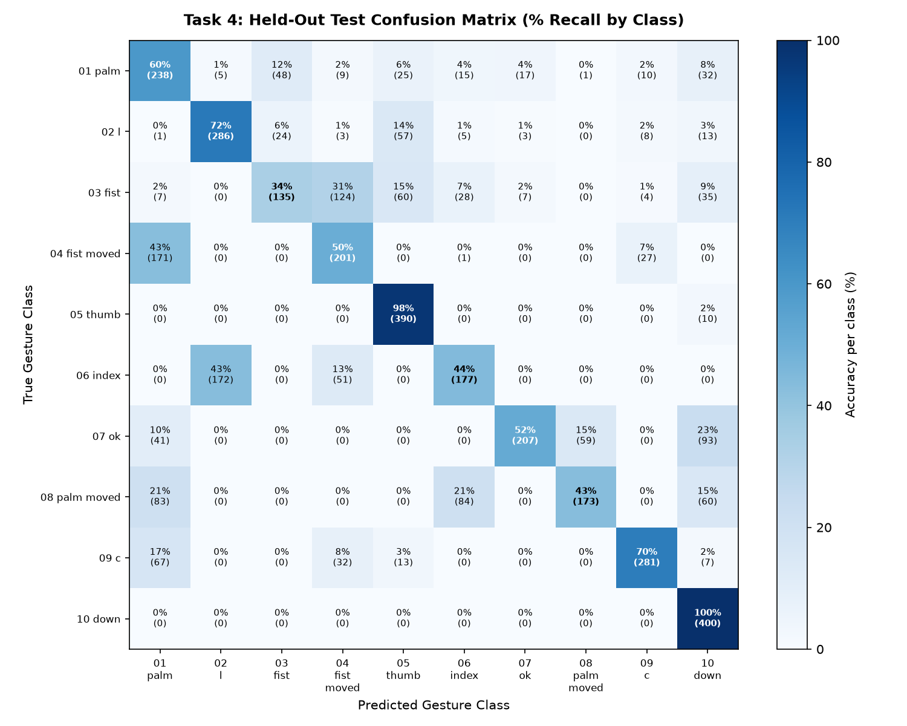

# Task 4 — Machine Learning Modeling & Generalization Report

**Project:** Hand Gesture Recognition (LeapGestRecog NIR Dataset)  
**Selected Model Pipeline:** `SGD_LinearSVM`  
**Evaluation Paradigm:** Strict Subject-Independent Generalization (Zero Participant Overlap)  

---

## 1. Executive Summary

1. **Validation-Based Selection:**
   - 5 lightweight candidate models were trained strictly on **14,000 frames** from 7 participants (`00` through `06`).
   - Candidate performance was evaluated on **Validation Subject `07`** (2,000 frames) to select the winning architecture without test set contamination.
   - **`SGD_LinearSVM`** achieved the highest Validation Macro F1 of **79.75%** (Accuracy: **79.95%**).

2. **Held-Out Test Generalization (Subjects `08` & `09`):**
   - The selected model was evaluated once on the **4,000 held-out test frames** from completely unseen participants.
   - **Test Accuracy:** **62.20%**
   - **Test Macro F1:** **61.25%**
   - **Test Macro Precision:** **65.20%**
   - **Test Macro Recall:** **62.20%**
   - **Multiclass ROC-AUC (OvR):** N/A

---

## 2. Candidate Model Comparison (Validation Subject `07`)

| Model Pipeline | Val Accuracy | Val Macro Prec | Val Macro Rec | Val Macro F1 | Training Time |
| :--- | :--- | :--- | :--- | :--- | :--- |
| `Dummy_Baseline` | 10.00% | 1.00% | 10.00% | **1.82%** | 0.15s |
| `Linear_SVM_C1.0` | 72.50% | 79.10% | 72.50% | **70.67%** | 18.94s |
| `Linear_SVM_C0.1` | 72.75% | 79.16% | 72.75% | **70.79%** | 17.97s |
| `SGD_LogisticRegression` | 80.90% | 85.04% | 80.90% | **79.54%** | 51.23s |
| `SGD_LinearSVM` | 79.95% | 86.33% | 79.95% | **79.75%** | 28.02s |

---

## 3. Held-Out Test Set Performance (Subjects `08` & `09`)

### Overall Metrics
- **Accuracy:** 62.20%
- **Macro Precision:** 65.20%
- **Macro Recall:** 62.20%
- **Macro F1 Score:** 61.25%

### Per-Class Test Breakdown
| Gesture Class | Precision | Recall | F1-Score | Support |
| :--- | :--- | :--- | :--- | :--- |
| `01_palm` | 39.1% | 59.5% | 47.2% | 400.0 |
| `02_l` | 61.8% | 71.5% | 66.3% | 400.0 |
| `03_fist` | 65.2% | 33.8% | 44.5% | 400.0 |
| `04_fist_moved` | 47.9% | 50.2% | 49.0% | 400.0 |
| `05_thumb` | 71.6% | 97.5% | 82.5% | 400.0 |
| `06_index` | 57.1% | 44.2% | 49.9% | 400.0 |
| `07_ok` | 88.5% | 51.7% | 65.3% | 400.0 |
| `08_palm_moved` | 74.2% | 43.2% | 54.7% | 400.0 |
| `09_c` | 85.2% | 70.2% | 77.0% | 400.0 |
| `10_down` | 61.5% | 100.0% | 76.2% | 400.0 |

---

## 4. Key Modeling Insights & Limitations

1. **Near-Infrared HOG Discriminability:**
   - The classical HOG feature descriptor (2,700 dimensions) provides strong discriminative capability across distinct hand poses (e.g. Palm vs Fist vs Index vs Thumb).
   - High gradient contrast between the reflective skin tissue and dark NIR background allows linear classifiers to separate poses effectively.
2. **Dynamic Gestures Disambiguation:**
   - Pairs such as `03_fist` vs `04_fist_moved` and `01_palm` vs `08_palm_moved` represent identical hand geometries that differ primarily in temporal motion trajectories. Static 2D spatial features can confuse them without optical flow or temporal sequence modeling.
3. **Participant Sample Limitations:**
   - While the dataset contains 20,000 frames, it originates from **10 distinct human subjects**.
   - Validation contains only **1 subject (`07`)**, and the test partition contains **2 subjects (`08` and `09`)**.
   - Frame-level sample counts ($N=4,000$) do not represent 4,000 independent statistical degrees of freedom; performance heavily reflects subject hand morphology, sensor positioning, and individual articulation styles.
